# MolSculpt: touchless molecule building with an agentic AI chemist

MolSculpt is a gesture-driven browser application in which you build organic molecules **in mid-air with your bare hand** in front of a normal webcam. A **Groq-powered AI agent** then characterises the compound you built: its identity, physicochemical profile, drug-likeness, biological activity, safety, and analogues worth exploring.

HCI term project · **Nisarg Vashi (23BCE370)** and **Heli Shah (23BCE093)**, Department of Computer Science and Engineering, Institute of Technology, Nirma University

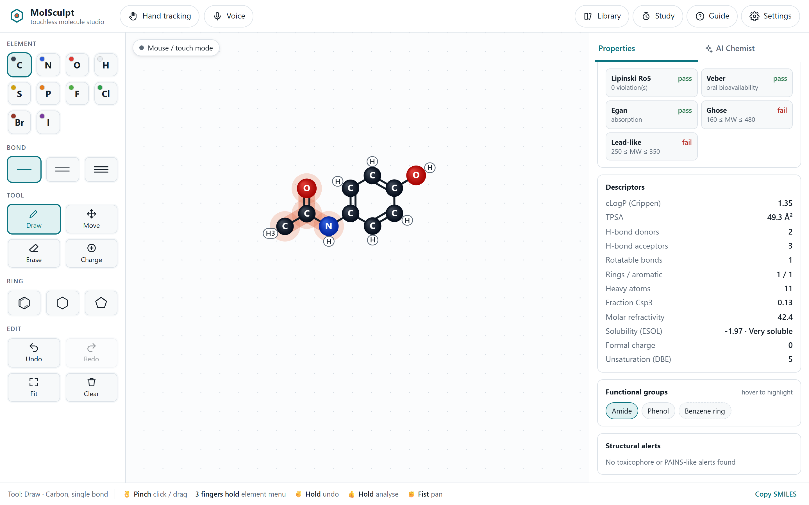

*Main window: tools on the left, the canvas in the middle, live properties on the right. Hovering a functional group (here the amide) highlights its atoms.*

- **Touchless input.** MediaPipe Hand Landmarker tracks 21 hand landmarks on-device. The camera image is never shown, stored or uploaded; only the hand skeleton is used.
- **Gesture vocabulary.** Pinch to click or drag. Hold ✌️ to undo, 👍 to analyse, and three fingers for a radial element menu. A ✊ fist pans the canvas, and an open ✋ palm is a safe rest pose. Hovering a button (dwell) presses it.
- **Assistive drawing.** Angle snapping (30°), fixed bond length, magnetic snapping to atoms and enlarged hit areas for hand input. Tapping an atom grows a zig-zag chain. Ring templates, and valence-aware error prevention.
- **Feedforward and feedback.** Ghost previews of the next atom or bond, dwell and hold progress rings, a virtual hand at the cursor, earcons and toasts.
- **Multimodal.** Mouse, touch, keyboard and voice commands ("oxygen", "double bond", "benzene", "undo", "analyse") all drive the same editor.
- **In-browser cheminformatics engine.** Written from scratch and validated against RDKit: SMILES I/O, SSSR rings, RDKit-model aromaticity, a SMARTS matcher, Wildman–Crippen logP and MR, Ertl TPSA, Lipinski, Veber, Egan, Ghose and lead-likeness filters, ESOL solubility, functional groups, and Brenk/PAINS-style alerts.
- **Agentic AI (Groq).** A ReAct-style tool-calling loop:
  - **Tools**: local descriptors, PubChem identity lookup, similarity search, structural alerts, drug-likeness, GHS safety.
  - **Output**: a schema-validated JSON report, with every tool step streamed live to the UI.
  - **Analogues**: suggestions are checked by the local engine and can be loaded back onto the canvas.
  - **Follow-ups**: you can ask questions about the result in chat.
- **User-study kit.** Timed tasks with automatic completion detection, interaction logging, SUS and NASA-TLX questionnaires, and CSV/JSON export.

## Quick start

Requirements: **Node.js 18.17+** (no `npm install` needed; the app has zero dependencies). Use Chrome or Edge on a machine with a webcam. The first start needs internet access to download the MediaPipe model and to reach PubChem.

**Windows:** double-click **`run.bat`**. On first run it creates `.env` and asks for your Groq key (press Enter to skip). It then starts the server and opens the app in your browser. Close the window to stop.

Manual start (any OS):

```bash
# 1. (optional but recommended) add your Groq key
copy .env.example .env        # Windows   (cp on macOS/Linux)
#    then edit .env:  GROQ_API_KEY=gsk_...   (free key: https://console.groq.com/keys)

# 2. start the server
npm start

# 3. open http://127.0.0.1:5173 and click "Hand tracking"
```

Without a Groq key the app still works. The AI Chemist then runs the same tools deterministically (local engine plus PubChem) and builds a template report without the LLM. You can also paste a key in **Settings**; it is kept in the browser and sent only to the local server.

### Using your hand

| Gesture | Action |
| --- | --- |
| ☝️ point / move | move the cursor (thumb–index midpoint) |
| 👌 pinch on empty canvas | place an atom of the selected element |
| 👌 pinch on an atom | grow a chain from it (or change its element) |
| 🤏 pinch-drag from an atom | draw a bond (snaps to 30° and to nearby atoms) |
| 👌 pinch on a bond | cycle single → double → triple |
| 🖐️ hold three fingers | radial element menu at the cursor |
| ✌️ hold victory | undo (keep holding to repeat) |
| 👍 hold thumbs-up | analyse with ChemAgent |
| ✊ fist | grab and pan the canvas |
| ✋ open palm | rest (never triggers anything) |
| hover a button ~1 s | dwell-click |

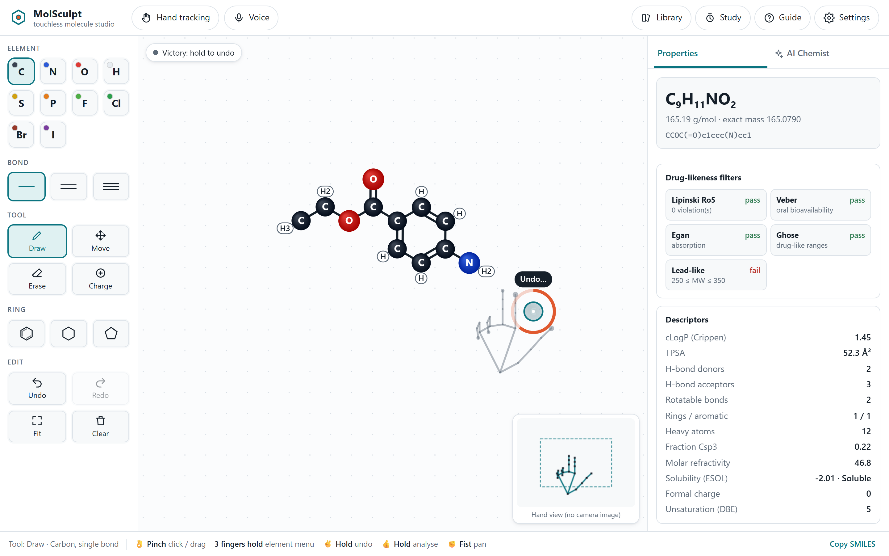

*Hand mode: a virtual hand follows the cursor, the orange ring fills while a ✌️ undo is being held, and the mini-map shows your hand skeleton inside the reach box. No camera image is shown. The hand in this screenshot is rendered from synthetic landmarks.*

<p align="center">
  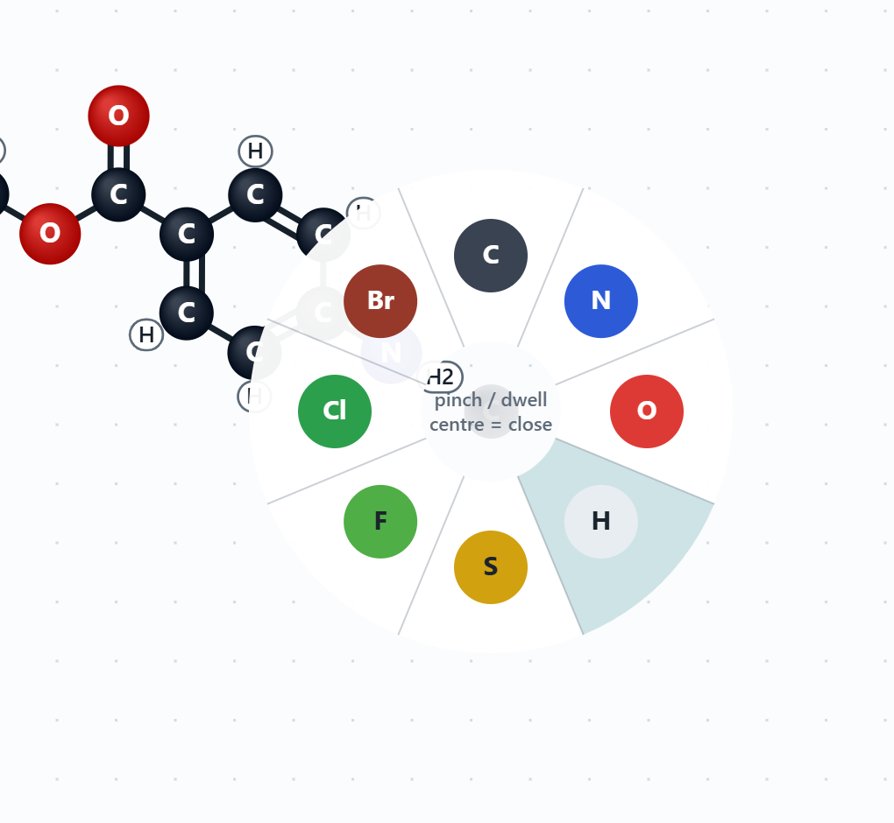
  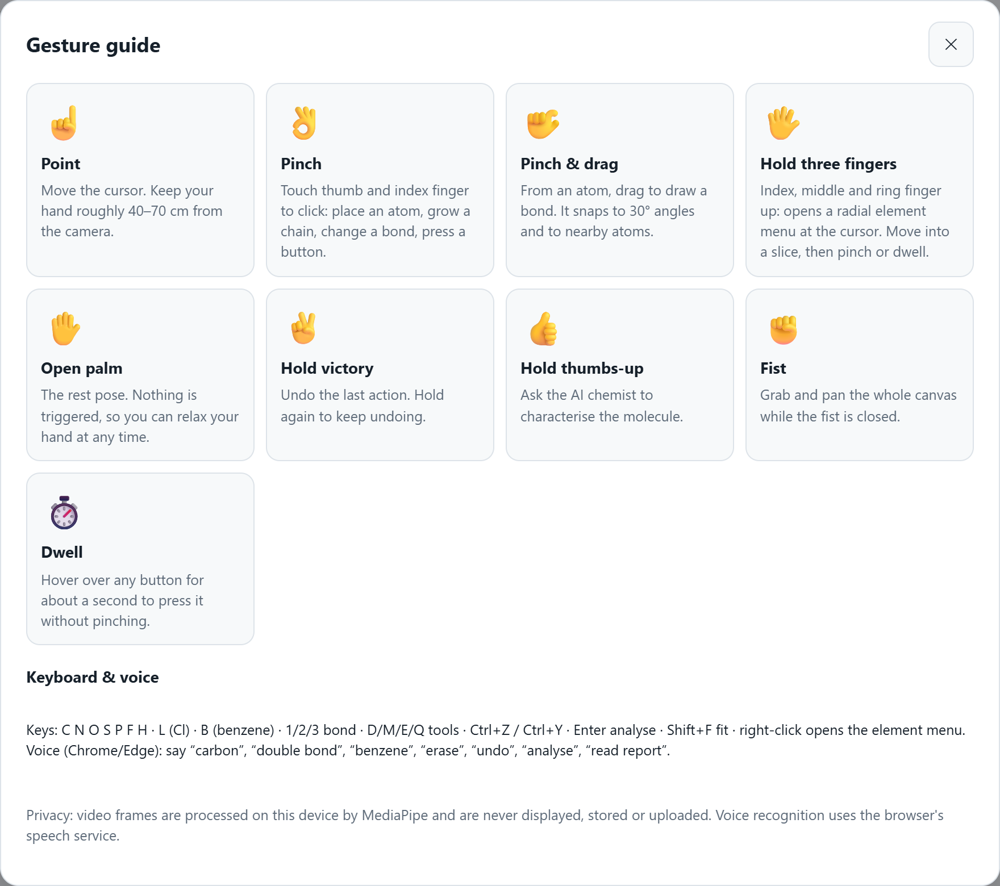
</p>

*Left: the radial element menu (hold three fingers, or right-click), where the hovered slice fills as you dwell. Right: the in-app gesture guide.*

Hold gestures fire only while the hand is still, which avoids "Midas touch" activations. **Settings** let you tune reach (control-display gain), smoothing, pinch sensitivity and dwell time.

Keyboard: `C N O S P F H`, `L`=Cl, `R`=Br, `I`; `1/2/3` bond order; `D/M/E/Q` tools; `B` benzene; `Ctrl+Z / Ctrl+Y`; `Enter` analyse; `Shift+F` fit; right-click opens the element menu.

## AI Chemist

Hold 👍, press **Characterise with ChemAgent**, or say "analyse". The report card gives identity, class, drug-likeness, biological activity, applications, safety, analogues and caveats. The trace underneath shows every tool the agent called and how long each call took.

<p align="center">
  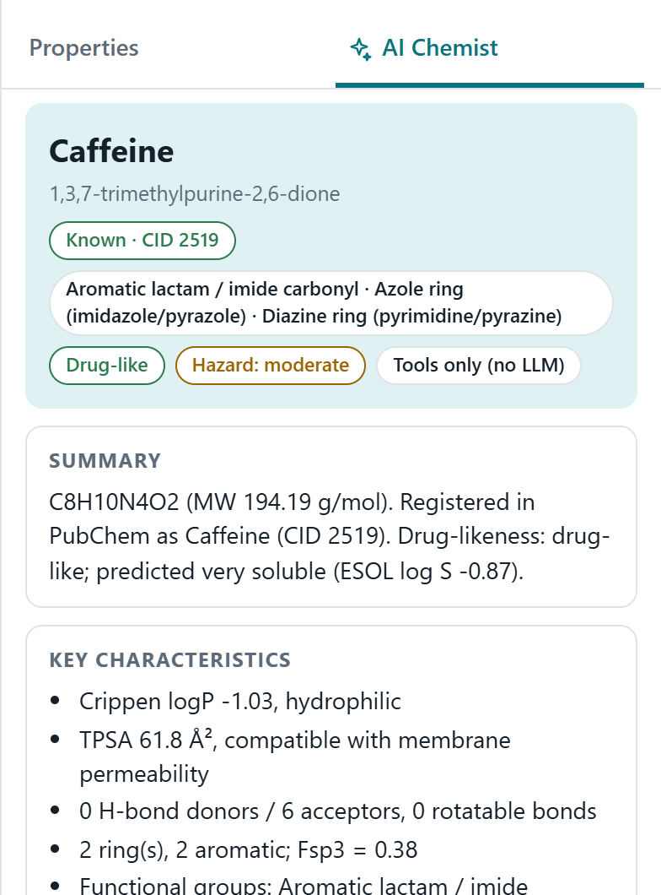
  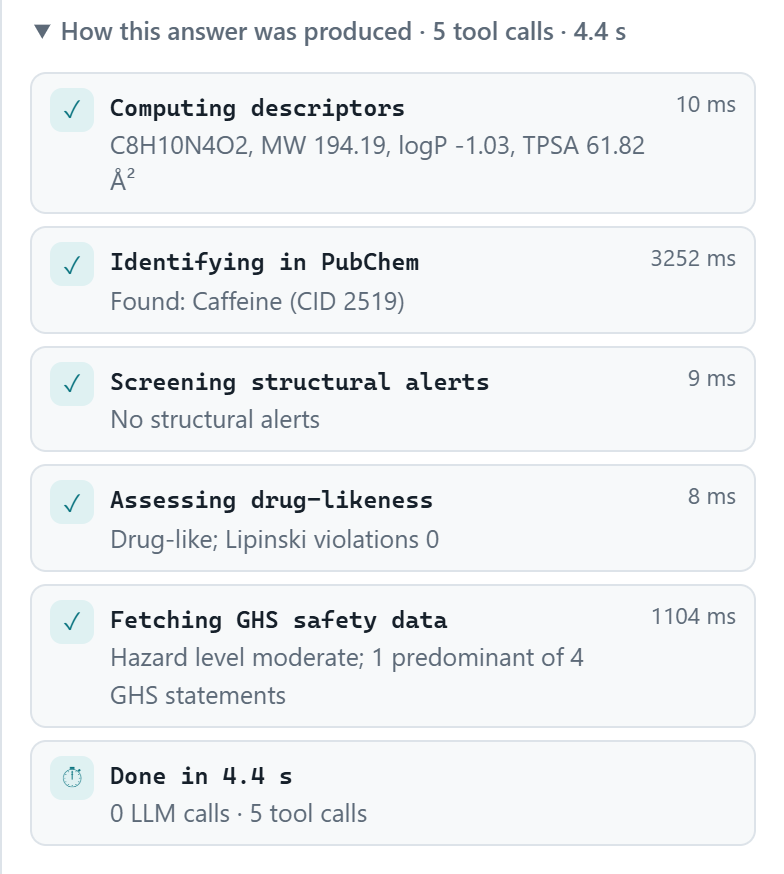
</p>

*Report card for caffeine (left) and the "How this answer was produced" trace (right). These screenshots are from offline mode, which runs without a Groq key.*

## Architecture

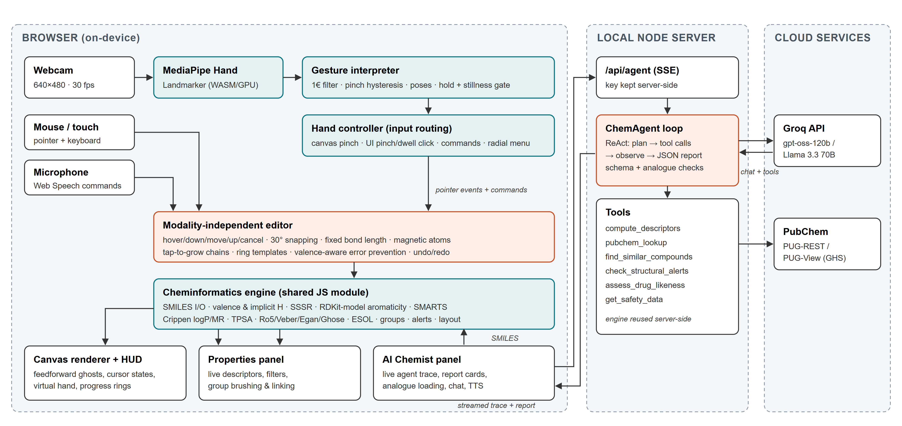

<p align="center">
  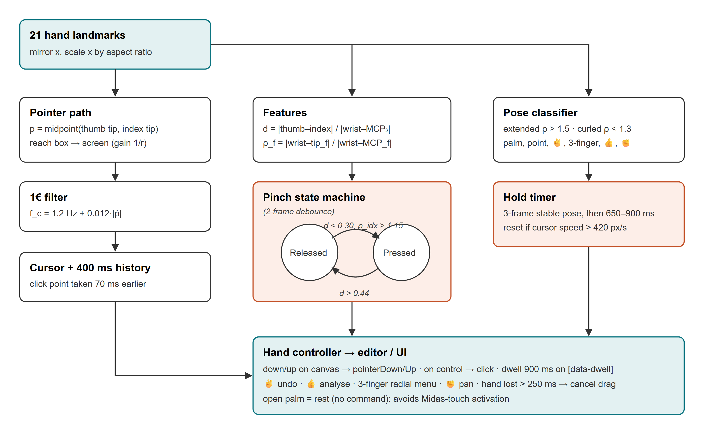
  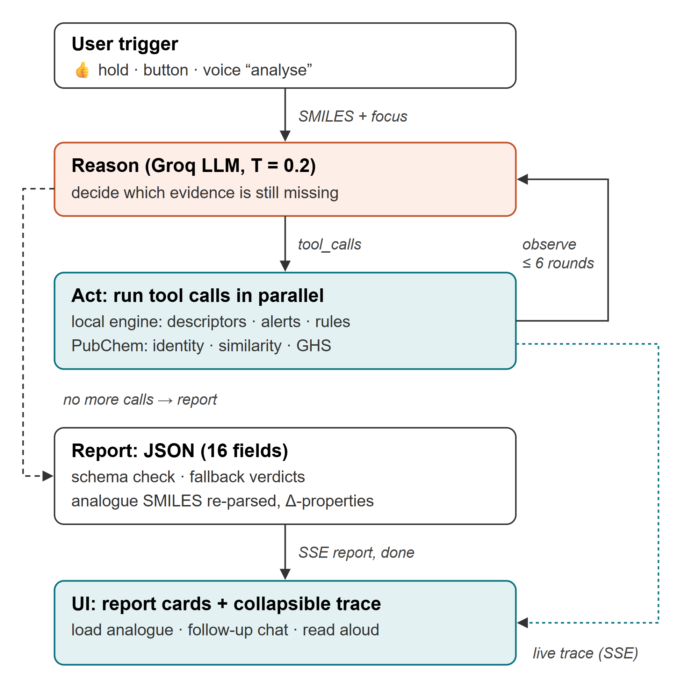
</p>

*Left: the gesture-recognition pipeline (1€-filtered pointer, pinch state machine with hysteresis, stillness-gated hold timers). Right: ChemAgent's reason-and-act loop.*

```text
public/                    browser app (ES modules, no build step)
  js/chem/                 cheminformatics engine (shared with the server)
    molecule.js perception.js rings.js smiles.js smarts.js crippen.js descriptors.js groups.js layout.js
  js/input/                hand-tracker.js (MediaPipe) · gestures.js · one-euro.js · hand-controller.js · voice.js
  js/ui/                   editor.js (interaction model) · renderer.js · hud.js · properties.js · agent-panel.js · study.js · library.js
server/                    zero-dependency Node server
  server.js                static files + /api/agent (Server-Sent Events) + /api/health /api/models /api/descriptors
  agent.js groq.js tools.js pubchem.js
tests/                     node:test suites (chemistry, gestures, server + mocked Groq agent)
evaluation/                validation against RDKit, ESOL data, latency and filter measurements
tools/make_templates.py    regenerates the molecule library with RDKit 2D coordinates
paper/                     term paper (DOCX/PDF) and figures
```

The Groq API key stays on the server. The browser calls `/api/agent`, and the server runs the tool loop: `compute_descriptors`, `pubchem_lookup`, `find_similar_compounds`, `check_structural_alerts`, `assess_drug_likeness` and `get_safety_data`. It streams `tool_call`, `tool_result`, `report` and `done` events. Runs are logged to `logs/agent-runs.jsonl` with latency and token counts, so you can report agent performance.

## Tests and evaluation

```bash
npm test                                   # 30 tests: chemistry, gestures, server/agent (mock Groq)
node evaluation/compute_js.mjs             # engine on the 60-molecule benchmark
python evaluation/rdkit_compare.py evaluation/results/js_descriptors.json evaluation/results benchmark
node evaluation/compute_js.mjs evaluation/data/esol_delaney.json evaluation/results/esol_js.json
python evaluation/rdkit_compare.py evaluation/results/esol_js.json evaluation/results esol
node evaluation/agent_latency.mjs          # per-tool latency (needs internet)
node evaluation/one_euro.mjs               # cursor-filter jitter/lag
```

`rdkit_compare.py` needs `pip install rdkit matplotlib`.

Results with RDKit 2026.09.1:

- **ESOL / Delaney set (1,128 molecules)**: 100% exact agreement on formula, heavy atoms, H-bond donors/acceptors, rotatable bonds and aromatic rings. MW, exact mass, Crippen logP, MR, TPSA and Fsp3 differ by at most 0.0000. Ring count agrees for 99.8%; the two exceptions are cage pesticides, where RDKit's symmetrised SSSR adds one ring.
- **SMILES round trip**: 100%.
- **Speed**: median full analysis 0.49 ms in Node.js.

<p align="center">
  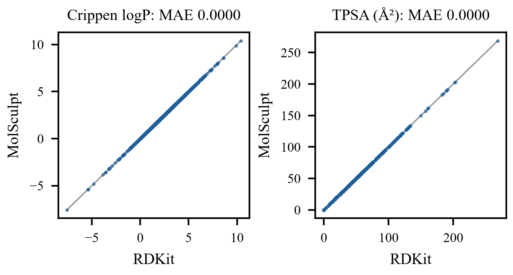
  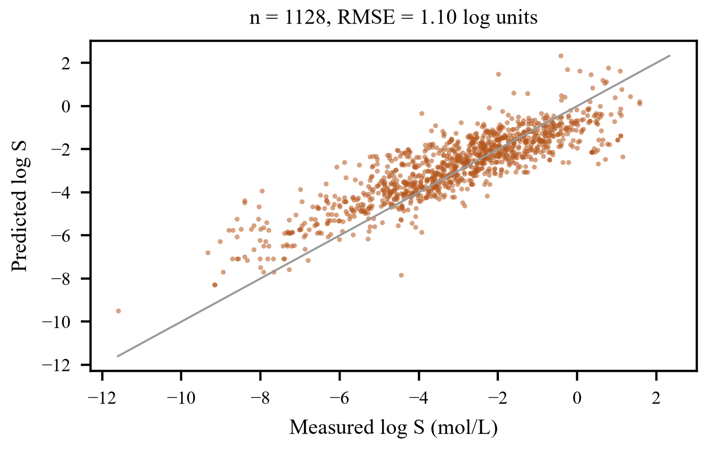
</p>

*Left: MolSculpt vs RDKit on the 1,128 ESOL molecules (all points on the identity line). Right: ESOL solubility estimate vs measured values (RMSE 1.10 log units).*

## Term paper

`paper/Term_Paper_23BCE370_23BCE093.docx` and `.pdf` contain the IEEE-style paper.

To regenerate the paper after changing results:

```bash
python paper/make_plots.py evaluation/results/esol_comparison.csv paper/figures
python paper/compose_figures.py paper/figures      # page-wide figures with captions
npm install --no-save docx@9 && node paper/build_paper.cjs
```

Diagram sources are in `paper/diagrams/diagrams.html`.

## Running a user study

Open **Study**, enter a participant ID and condition (hand / mouse / hand + voice), and run tasks T1–T5. Each trial ends automatically when the drawn molecule matches the target (graph signature). Record SUS and NASA-TLX at the end, then export the CSV files. A counterbalanced within-subjects protocol is described in the term paper.

<p align="center">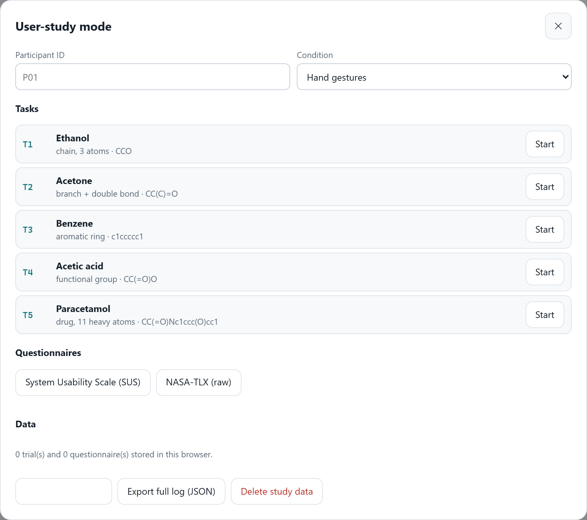</p>

## Privacy and safety

- Video frames are processed locally and never leave the browser. Voice recognition uses the browser's speech service.
- The server binds to `127.0.0.1` by default.
- The agent treats tool output as data, never as instructions. It gives only conceptual synthesis ideas and declines synthesis information for hazardous or controlled substances.
- AI output is advisory and must be checked by a chemist.
